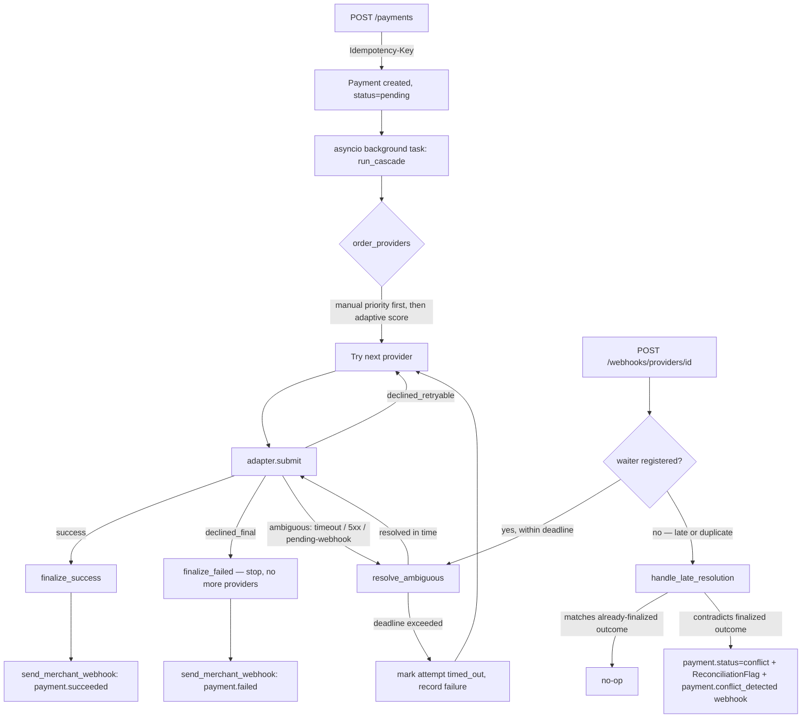

# Payment Cascading Gateway

A payment gateway that creates deposit/withdraw payments, routes them through mock
payment providers, and **cascades** to the next provider on a retryable failure —
while being careful never to double-charge when a provider's response is ambiguous
(timeout, 5xx) or arrives late.

Design doc: [`docs/superpowers/specs/2026-11-11-payment-cascading-design.md`](docs/superpowers/specs/2026-11-11-payment-cascading-design.md)
Implementation plan: [`docs/superpowers/plans/2026-11-11-payment-cascading-implementation.md`](docs/superpowers/plans/2026-11-11-payment-cascading-implementation.md)

## Architecture



**Core pieces** (`app/`):

- `providers/` — three mock adapters (`fast_sync`, `webhook_async`, `flaky`), each
  using a *different* response convention (HTTP status code, `200` + body, or a
  mix), and each normalizing its own raw response into one shared `AttemptOutcome`
  shape. Nothing outside `app/providers/*` ever looks at a raw HTTP status.
- `routing.py` / `stats.py` — provider ordering: manual `priority` wins if set on
  any eligible provider; otherwise providers rank by a Laplace-smoothed adaptive
  success score, `(success+1)/(success+failure+2)`.
- `cascade.py` — the orchestrator. A `declined_final` outcome (fraud, insufficient
  funds) stops the whole cascade immediately — retrying elsewhere would just fail
  again everywhere. A `declined_retryable` outcome moves to the next provider. An
  `ambiguous` outcome is never treated as a failure outright: `reconciliation.py`
  either polls the provider's status-check endpoint or waits for its webhook, up to
  a deadline, before the cascade is allowed to continue.
- `webhooks.py` — outgoing merchant webhooks (HMAC-signed, retried with backoff) and
  the in-process event bus that wakes up a waiting `reconciliation.resolve_ambiguous`
  call when a provider's webhook arrives in time.
- `idempotency.py` — `Idempotency-Key` enforcement: same key + same payload replays
  the original payment; same key + a different payload is a `409`.
- `handle_late_resolution` (in `cascade.py`) — the late/duplicate webhook path. If a
  webhook arrives after the cascade already moved past that attempt, this is the
  only place that can discover **two providers both reporting success for the same
  payment**. It never silently picks one: it flags `payment.status = conflict`,
  writes a `ReconciliationFlag`, and fires a dedicated `payment.conflict_detected`
  webhook instead of touching the already-sent `payment.succeeded`/`payment.failed`
  event.

## Running it

```bash
docker-compose up -d          # postgres on localhost:5432
python3 -m venv .venv && .venv/bin/pip install -e ".[dev]"
.venv/bin/alembic upgrade head
.venv/bin/uvicorn app.main:app --reload
```

## Running the tests

Tests run against an in-memory SQLite engine (see `tests/conftest.py`), not
Postgres, so no running database is required:

```bash
.venv/bin/pip install -e ".[dev]"
.venv/bin/pytest -v
```

## Demoing each corner case

All of these are implemented as automated tests in `tests/test_corner_cases.py`;
the curl examples below assume a running server with providers seeded (the test
suite seeds them in-memory via the `seed_providers` fixture — for a live demo,
insert the same three `Provider` rows via a one-off script or `psql`).

**Manual priority overrides adaptive history** — a provider with a long success
history still loses to a manually-prioritized provider:

```bash
curl -X POST localhost:8000/payments \
  -H "Idempotency-Key: demo-1" -H "Content-Type: application/json" \
  -d '{"direction":"deposit","amount":1000,"currency":"USD","card_bin":"411111",
       "card_type":"visa","callback_url":"https://example.test/cb",
       "provider_scenarios":{"fast_sync":"insufficient_funds"}}'
```

**Final decline stops the cascade** (no further providers tried):

```bash
curl -X POST localhost:8000/payments \
  -H "Idempotency-Key: demo-2" -H "Content-Type: application/json" \
  -d '{"direction":"deposit","amount":1000,"currency":"USD","card_bin":"411111",
       "card_type":"visa","callback_url":"https://example.test/cb",
       "provider_scenarios":{"fast_sync":"fraud_suspected"}}'
```

**Retryable decline cascades to the next provider:**

```bash
curl -X POST localhost:8000/payments \
  -H "Idempotency-Key: demo-3" -H "Content-Type: application/json" \
  -d '{"direction":"deposit","amount":1000,"currency":"USD","card_bin":"411111",
       "card_type":"visa","callback_url":"https://example.test/cb",
       "provider_scenarios":{"fast_sync":"processing_error"}}'
```

**All providers exhausted:**

```bash
curl -X POST localhost:8000/payments \
  -H "Idempotency-Key: demo-4" -H "Content-Type: application/json" \
  -d '{"direction":"deposit","amount":1000,"currency":"USD","card_bin":"411111",
       "card_type":"visa","callback_url":"https://example.test/cb",
       "provider_scenarios":{"fast_sync":"processing_error","flaky":"declined_via_body"}}'
```

**Duplicate POST with the same Idempotency-Key is a no-op** (returns the original
payment, `200` instead of `202`):

```bash
curl -X POST localhost:8000/payments -H "Idempotency-Key: demo-5" \
  -H "Content-Type: application/json" -d '{...}'
curl -X POST localhost:8000/payments -H "Idempotency-Key: demo-5" \
  -H "Content-Type: application/json" -d '{...}'   # same body -> 200, same id
```

**Duplicate webhook delivery is a no-op:**

```bash
curl -X POST localhost:8000/webhooks/providers/webhook_async \
  -d '{"attempt_id":"<id>","status":"approved"}'
curl -X POST localhost:8000/webhooks/providers/webhook_async \
  -d '{"attempt_id":"<id>","status":"approved"}'   # repeat -> still 200, no second webhook
```

**Late webhook after the cascade already moved on flags a conflict:**

```bash
# attempt already marked timed_out and superseded by a later provider's success
curl -X POST localhost:8000/webhooks/providers/webhook_async \
  -d '{"attempt_id":"<timed-out-attempt-id>","status":"approved"}'
# GET /payments/<id> now shows status: "conflict"
```

**Adaptive routing prefers the provider with the better success history** (no
manual priority set on either):

```bash
curl -X POST localhost:8000/payments \
  -H "Idempotency-Key: demo-8" -H "Content-Type: application/json" \
  -d '{"direction":"deposit","amount":1000,"currency":"USD","card_bin":"411111",
       "card_type":"visa","callback_url":"https://example.test/cb",
       "provider_scenarios":{"fast_sync":"success","flaky":"declined_via_http"}}'
```

## Limitations / what I'd do differently with more time

- **No external task broker.** The cascade runs as an in-process `asyncio` task,
  not a Celery/RQ job. If the process restarts mid-cascade, that payment is stuck
  `pending` forever — there's no crash recovery. In production this would be a
  durable queue (Celery/RQ + Redis, or Postgres-backed job table with a poller).
- **No auth.** There's no API key / merchant identity on requests. Every payment
  belongs to a single implicit merchant (see below).
- **No multi-tenancy.** The schema has no merchant/account concept — one logical
  merchant, one `callback_url` per payment. A real system would scope providers,
  routing rules, and stats per merchant.
- **No automatic reversal on conflict.** When a late webhook reveals two providers
  both reported success for the same payment, the system flags `status=conflict`
  and stops — it does not attempt to automatically refund or reverse the duplicate.
  That's a deliberate choice: reversal (especially for withdrawals, where money
  already left to the end user) is a business/compliance decision, not something
  safe to automate in a 24-hour scope.
- **`provider_scenarios` is a testing/demo hook.** Real providers wouldn't need a
  payload field telling them what to do — this exists purely so the three mock
  providers' behavior is deterministic and demoable through the real API instead of
  only through internal unit tests.
- **Reconciliation deadline is a single global default (10s).** A real system would
  likely tune this per provider (a provider with a known slow settlement window
  needs a longer deadline than one that's normally synchronous).
